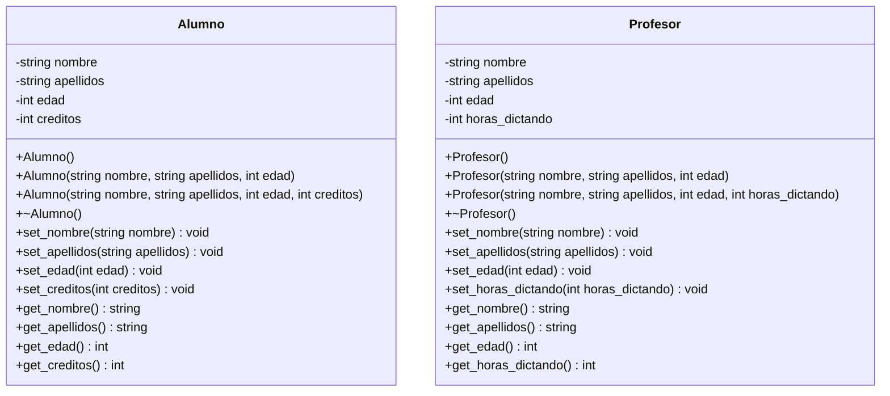

# A1 – Alumno y Profesor

## Diagrama de clase

## Preguntas de la sesión

| Versión | ¿Cómo se manifiesta el destructor? | ¿Se llama solo 2 veces? | ¿Fuga de memoria? |
|---------|-----------------------------------|-------------------------|-------------------|
| Por valor | Se imprime el mensaje al salir de cada función y al salir del bloque | No: cada llamada por valor crea una copia que también se destruye | No |
| Por puntero (`&objeto`) | Solo al salir del bloque | Sí, 2 veces | No |
| Dinámico (`new`) | Solo cuando se hace `delete` | Sí, pero solo si se hace `delete` | Sí, si se omite `delete` |
