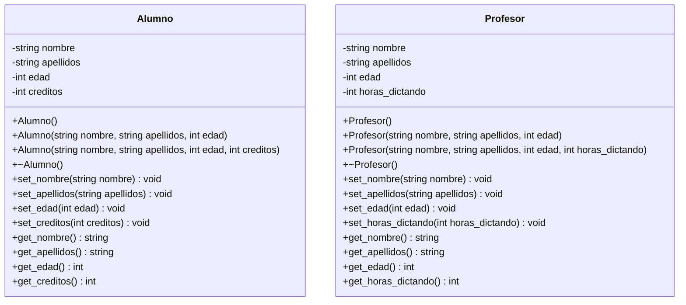

# A1 – Alumno y Profesor

## Diagrama de clase

## Preguntas de la sesión

| Versión | ¿Cómo se manifiesta el destructor? | ¿Se llama solo 2 veces? | ¿Fuga de memoria? |
|---------|-----------------------------------|-------------------------|-------------------|
| Por valor | Se imprime el mensaje al salir de cada función y al salir del bloque | No: cada llamada por valor crea una copia que también se destruye | No |
| Por puntero (`&objeto`) | Solo al salir del bloque | Sí, 2 veces | No |
| Dinámico (`new`) | Solo cuando se hace `delete` | Sí, pero solo si se hace `delete` | Sí, si se omite `delete` |

## Tareas

- [ ] **1. Clase `Alumno`.** Crea `Alumno.h` y `Alumno.cpp` con los atributos privados `nombre`, `apellidos`, `edad` y `creditos`.
- [ ] **2. Constructores.** Implementa al menos dos: uno vacío y uno con parámetros. *Pista: dentro del constructor usa `this->` para distinguir el atributo del parámetro.*
- [ ] **3. Destructor.** Haz que imprima un mensaje, por ejemplo `Eliminándose objeto de la clase Alumno`. *Pista: incluye el nombre en el mensaje para saber qué objeto se destruye.*
- [ ] **4. Setters y getters.** Uno por cada atributo.
- [ ] **5. Clase `Profesor`.** Repite los pasos 1 a 4 cambiando `creditos` por `horas_dictando`.
- [ ] **6. Funciones por valor.** En `funciones.h` y `funciones.cpp` crea `imprimir_datos_basicos(Alumno)` y `imprimir_datos_basicos(Profesor)`. Deben mostrar nombre, apellidos y edad.
- [ ] **7. Prueba por valor.** En `main`, crea un `Alumno` y un `Profesor` dentro de un bloque `{ }` y llama a las funciones. Cuenta los mensajes del destructor y responde: ¿cómo se manifiesta?, ¿se llama solo 2 veces?
- [ ] **8. Funciones por puntero.** Agrega `imprimir_datos_basicos(Alumno*)` y `imprimir_datos_basicos(Profesor*)`. *Pista: con un puntero se accede con `->`.* Llámalas pasando `&objeto` y compara el número de mensajes con el paso 7.
- [ ] **9. Objetos dinámicos.** Crea los objetos con `new`, llama a las funciones con el puntero y libera con `delete`. Responde: ¿qué pasa con el destructor si omites el `delete`? ¿hay fuga de memoria?
