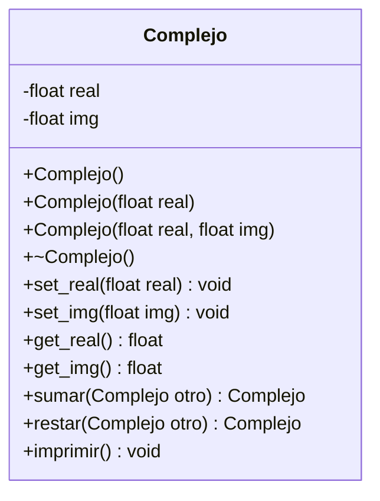

# A2 – Números complejos

## Diagrama de clase

## Fórmulas

- z1 + z2 = (x1 + x2) + (y1 + y2)i
- z1 − z2 = (x1 − x2) + (y1 − y2)i

## Tareas

- [ ] **1. Proyecto.** Crea `Complejo.h`, `Complejo.cpp` y `main.cpp`.
- [ ] **2. Atributos.** En el `.h`, declara `real` e `img` como `float` privados.
- [ ] **3. Constructores.** Implementa tres: vacío (0 + 0i), solo con `real` (la parte imaginaria queda en 0) y con ambos valores.
- [ ] **4. Destructor.** Impleméntalo. Puede quedar vacío porque no hay memoria dinámica.
- [ ] **5. Setters y getters** de `real` e `img`.
- [ ] **6. `imprimir()`.** Muestra el número como `3 + 2i`. *Pista: si `img` es negativo, imprime `3 - 4i` y no `3 + -4i`.*
- [ ] **7. `sumar` y `restar`.** Cada método recibe otro `Complejo` y devuelve un `Complejo` nuevo. Usa las fórmulas de arriba. *Pista: el resultado se construye con `Complejo(parte_real, parte_imaginaria)`.*
- [ ] **8. Prueba.** En `main`, crea dos complejos, suma y resta, e imprime. Compara con el cálculo hecho a mano.
- [ ] **9. Objeto dinámico.** Crea un complejo con `new`, llama a `sumar` con `->` y libéralo con `delete`.
