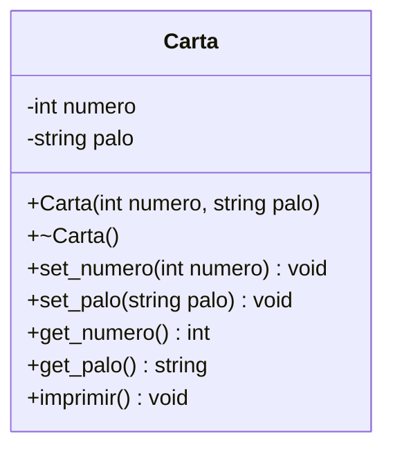

# B1 – Cartas

## Diagrama de clase

## Símbolos de los palos

| HEX | Símbolo | Palo |
|-----|---------|------|
| 0x2660 | ♠ | picas |
| 0x2663 | ♣ | treboles |
| 0x2665 | ♥ | corazones |
| 0x2666 | ♦ | diamantes |

## Tareas

- [ ] **1. Proyecto.** Crea `Carta.h`, `Carta.cpp` y `main.cpp`.
- [ ] **2. Atributos.** `numero` (entero de 1 a 13) y `palo` (texto), privados.
- [ ] **3. Constructor y destructor.** El constructor recibe número y palo.
- [ ] **4. Setters y getters** de los dos atributos.
- [ ] **5. `imprimir()`.** Muestra el símbolo del palo seguido del valor, por ejemplo `♠A` o `♥10`. Usa la tabla de símbolos de arriba. *Pista: los símbolos se pueden escribir como texto Unicode, por ejemplo `"\u2660"`.*
- [ ] **6. Figuras.** El 1 se imprime como `A`, el 11 como `J`, el 12 como `Q` y el 13 como `K`.
- [ ] **7. Prueba.** En `main`, crea varias cartas como objetos estáticos y una con `new`. Imprímelas y libera la dinámica con `delete`.
