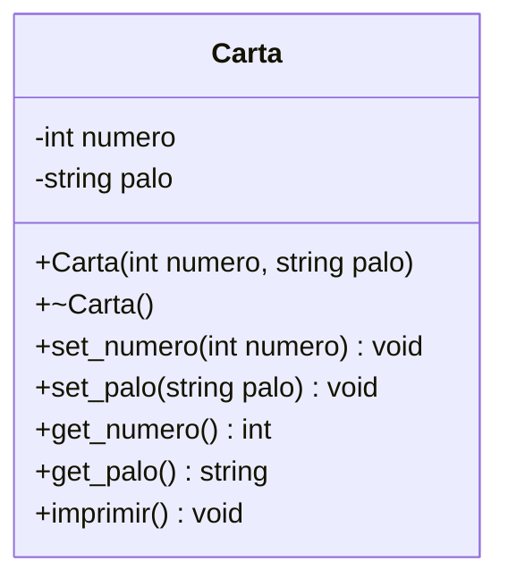

# B1 – Cartas

## Diagrama de clase

## Símbolos de los palos

| HEX | Símbolo | Palo |
|-----|---------|------|
| 0x2660 | ♠ | picas |
| 0x2663 | ♣ | treboles |
| 0x2665 | ♥ | corazones |
| 0x2666 | ♦ | diamantes |
