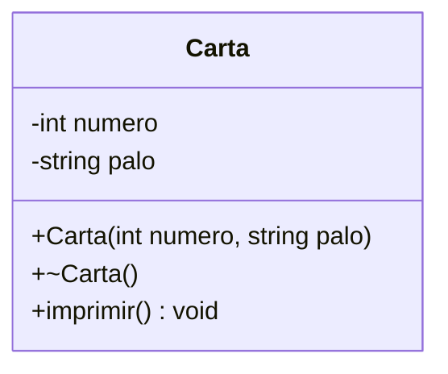

# B2 – El juego de cartas

Continuación de B1: reutiliza la clase `Carta`.

## Diagrama de flujo

## Diagrama de clase

## Tareas

- [ ] **1. Clase `Carta`.** Copia `Carta.h` y `Carta.cpp` de B1 en este proyecto.
- [ ] **2. El mazo.** En `main`, declara `mazo` como un arreglo de 52 punteros a `Carta`.
- [ ] **3. Llenar el mazo.** Recorre los 4 palos y los 13 números. Cada carta debe crearse con `new`.
- [ ] **4. Mostrar el mazo ordenado.** Imprime las cartas, por ejemplo 13 por línea.
- [ ] **5. Mezclar el mazo.** Eres libre de elegir el camino. *Pista: no hace falta copiar cartas, basta con intercambiar punteros. Para números aleatorios usa `rand()` y `srand(time(nullptr))`.*
- [ ] **6. Mostrar el mazo mezclado.**
- [ ] **7. Liberar la memoria.** Haz `delete` de cada carta del mazo. Comprueba que no quedan cartas sin liberar.
