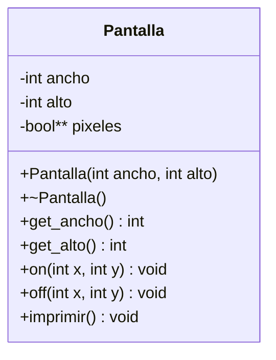

# B3 – Pantalla

## Diagrama de flujo

## Diagrama de clase

## Tareas

- [ ] **1. Proyecto.** Crea `Pantalla.h`, `Pantalla.cpp` y `main.cpp`.
- [ ] **2. Atributos.** `ancho`, `alto` y `pixeles` (`bool**`), privados.
- [ ] **3. Constructor.** Crea la matriz dinámica. *Pista: primero un arreglo de `alto` punteros; luego, para cada fila, un arreglo de `ancho` valores `bool`. Inicia todos en `false`.*
- [ ] **4. Destructor.** Libera la memoria en orden inverso: primero cada fila y después el arreglo de filas.
- [ ] **5. Getters** de `ancho` y `alto`.
- [ ] **6. `on(x, y)` y `off(x, y)`.** Encienden y apagan un píxel. *Pista: `x` es la columna y `y` es la fila. Valida que las coordenadas estén dentro de la pantalla.*
- [ ] **7. `imprimir()`.** Recorre la matriz y muestra un símbolo distinto para encendido y apagado. Elige de la tabla de caracteres Unicode de la PPT.
- [ ] **8. Menú en `main`.** Crea una pantalla, pide las coordenadas X e Y, enciende el píxel, imprime y pregunta `¿Encender una casilla más? [s/n]`.
- [ ] **9. Prueba de límites.** Intenta encender una coordenada fuera de la pantalla y verifica que el programa no se cae.
