# Ejercicios propuestos – Semana 10 (POO)

Ejercicios adicionales para los alumnos que terminen antes. Solo usan lo visto en la Semana 10: **constructores y destructores, objetos dinámicos (`new` / `delete`), punteros a objetos, arreglos de objetos, arreglos de punteros a objetos y matrices dinámicas** (sin relaciones entre clases ni herencia).

| # | Ejercicio | Tipo | Tiempo aprox. |
|---|-----------|------|---------------|
| 1 | Rastro de vida de un objeto | Nuevo | 10 min |
| 2 | Complejos → arreglo dinámico | Extensión de A2 | 10–15 min |
| 3 | Alumnos → arreglo de punteros | Extensión de A1 | 15–20 min |
| 4 | Cartas → repartir una mano | Extensión de B2 | 15–20 min |
| 5 | Cartas → contar por palo | Extensión de B2 | 10–15 min |
| 6 | Pantalla → línea y rectángulo | Extensión de B3 | 15 min |
| 7 | Pantalla → limpiar e invertir | Extensión de B3 | 10–15 min |
| 8 | Pantalla → punto en movimiento | Reto | 20–25 min |

---

## 1. Rastro de vida de un objeto

**Enunciado.** Cree la clase `Marca` con un atributo `nombre`. Su constructor imprime `Creando X` y su destructor imprime `Destruyendo X`. En el `main` cree:

- un objeto normal `Marca a("a")`,
- un objeto dinámico `Marca* b = new Marca("b")`,
- un arreglo dinámico `Marca* c = new Marca[3]` (agregue un constructor sin parámetros que use el nombre `"c"`),
- libere `b` con `delete` y `c` con `delete[]`.

**Antes de ejecutar**, escriba en papel el orden en que cree que aparecerán los mensajes. Luego compare. Pruebe también qué pasa si se omite el `delete` de `b`.

**Conceptos:** cuándo se llama al destructor, `delete` vs `delete[]`, fuga de memoria.

**Diagrama de clase**

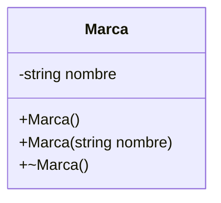

**Diagrama de flujo – programa principal**

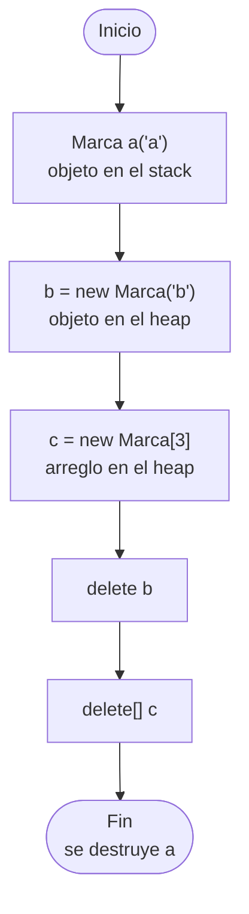

---

## 2. Complejos → arreglo dinámico

**Enunciado.** Con la clase `Complejo` de A2, pida al usuario un entero `n` y cree un arreglo dinámico de `n` complejos con `new Complejo[n]`. Lea los valores real e imaginario de cada uno con `set_real` y `set_img`, calcule la **suma de todos** con el método `sumar` e imprima el resultado. Libere el arreglo con `delete[]`.

**Conceptos:** arreglo dinámico de objetos, constructor sin parámetros, `delete[]`.

**Diagrama de clase** (sin cambios respecto a A2)

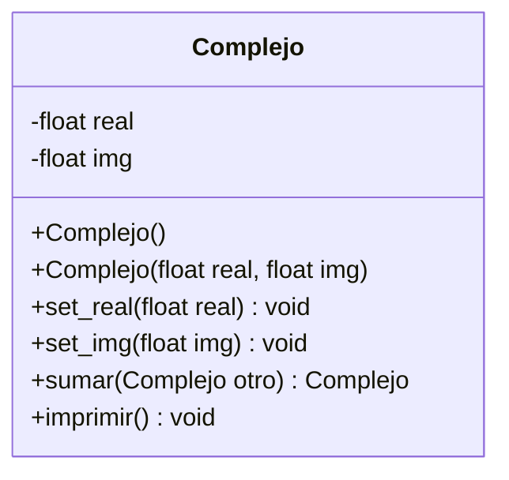

**Diagrama de flujo – programa principal**

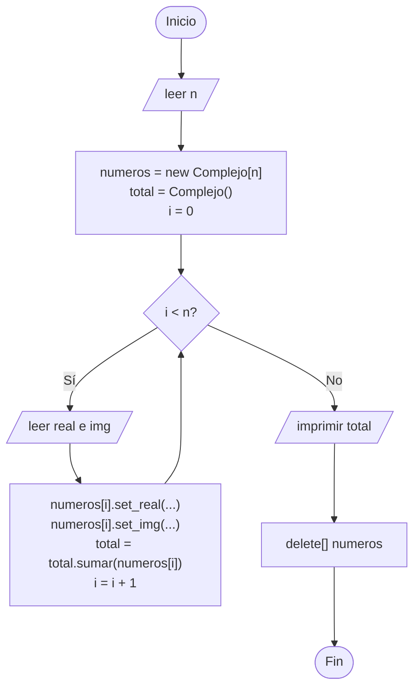

---

## 3. Alumnos → arreglo de punteros

**Enunciado.** Con la clase `Alumno` de A1, cree un arreglo dinámico de punteros `Alumno** alumnos = new Alumno*[n]`. Cada posición debe apuntar a un alumno creado con `new` (pida nombre, apellidos, edad y créditos por teclado). Luego:

- muestre el alumno con **mayor cantidad de créditos**,
- libere la memoria: primero cada alumno con `delete alumnos[i]` y después el arreglo con `delete[] alumnos`.

Observe en la consola los mensajes del destructor: debe aparecer uno por alumno.

**Conceptos:** arreglo de punteros a objetos, liberación en dos pasos, buscar el mayor elemento.

**Diagrama de clase** (sin cambios respecto a A1)

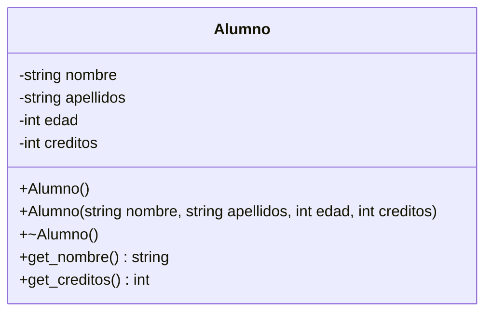

**Diagrama de flujo – programa principal**

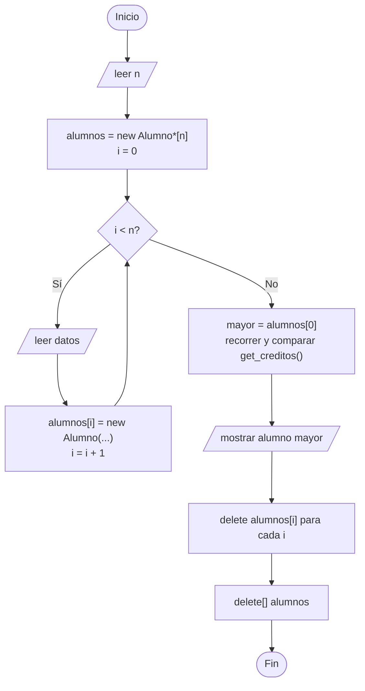

---

## 4. Cartas → repartir una mano

**Enunciado.** Continúe el juego de cartas de B2. Después de mezclar el mazo, reparta **5 cartas** a un jugador: declare `Carta* mano[5]` y copie los **punteros** de las primeras 5 posiciones del mazo (no se crean cartas nuevas). Deje esas posiciones del mazo en `nullptr`.

Muestre la mano y el mazo restante. Al final libere las cartas de la mano y las del mazo que no sean `nullptr`.

**Conceptos:** mover punteros entre arreglos sin copiar objetos, `nullptr`, evitar liberar dos veces el mismo objeto.

**Diagrama de clase** (se reutiliza `Carta` de B1)

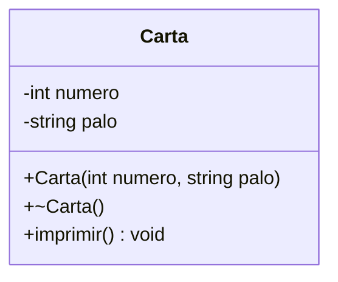

**Diagrama de flujo – programa principal**

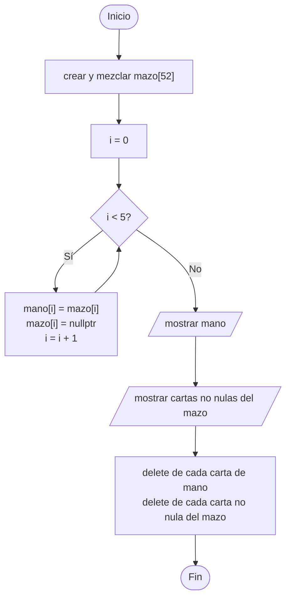

---

## 5. Cartas → contar por palo

**Enunciado.** Con la mano de 5 cartas del ejercicio anterior (o con el mazo completo), cuente cuántas cartas hay de cada palo. Implemente una función `contar_palo(Carta* cartas[], int n, string palo)` que reciba el arreglo de punteros y devuelva la cantidad. Muestre el conteo de los cuatro palos.

**Conceptos:** recorrer un arreglo de punteros con `->`, funciones que reciben arreglos de punteros.

**Diagrama de clase** (sin cambios respecto a B1)

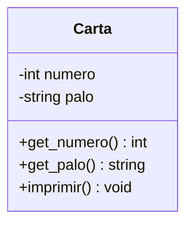

**Diagrama de flujo – `contar_palo(cartas, n, palo)`**

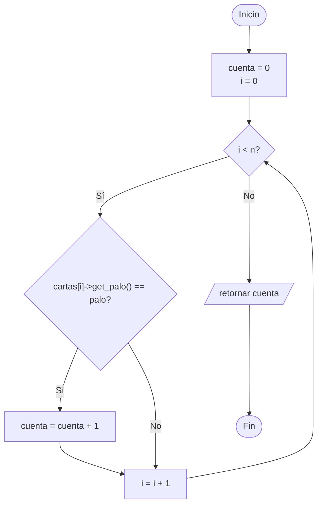

---

## 6. Pantalla → línea y rectángulo

**Enunciado.** Con la clase `Pantalla` de B3, agregue dos métodos:

- `linea_horizontal(int y, int x1, int x2)`: enciende los píxeles de la fila `y` entre `x1` y `x2`.
- `rectangulo(int x, int y, int ancho, int alto)`: dibuja solo el **borde** de un rectángulo con esquina superior izquierda en `(x, y)`.

En el `main` dibuje un marco que rodee toda la pantalla y una línea en el centro.

**Conceptos:** recorrer la matriz dinámica, reutilizar `on()` (que ya valida los límites).

**Diagrama de clase**

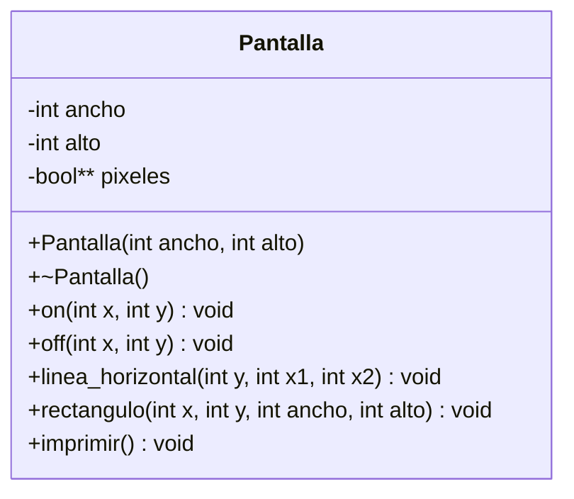

**Diagrama de flujo – `linea_horizontal(y, x1, x2)`**

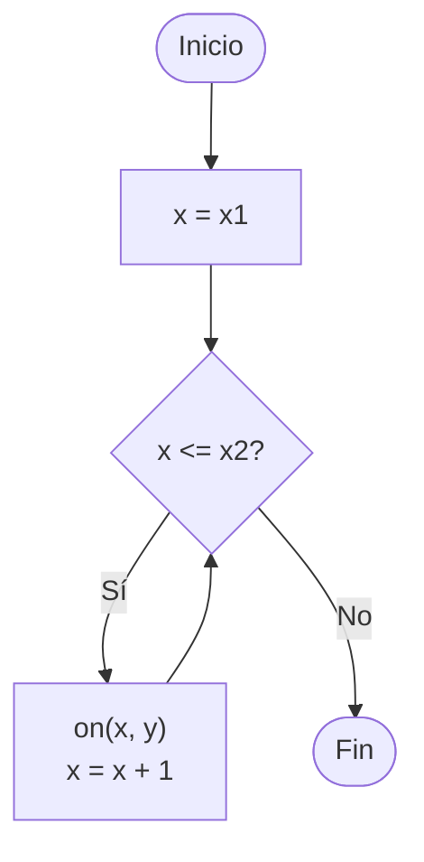

---

## 7. Pantalla → limpiar e invertir

**Enunciado.** Agregue a `Pantalla`:

- `limpiar()`: apaga todos los píxeles.
- `invertir()`: enciende los apagados y apaga los encendidos.
- `contar_encendidos() const`: devuelve cuántos píxeles están encendidos.

En el `main`, encienda algunos píxeles, invierta la pantalla, muestre el conteo y finalmente limpie.

**Conceptos:** doble recorrido de una matriz dinámica, métodos que modifican el estado interno.

**Diagrama de clase**

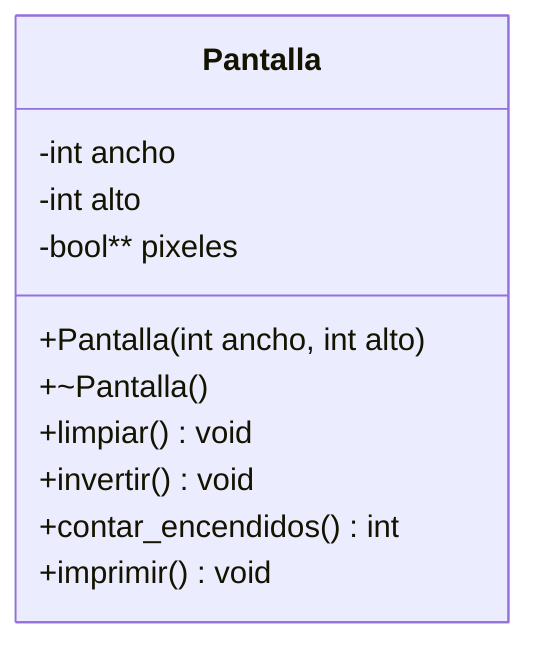

**Diagrama de flujo – `invertir()`**

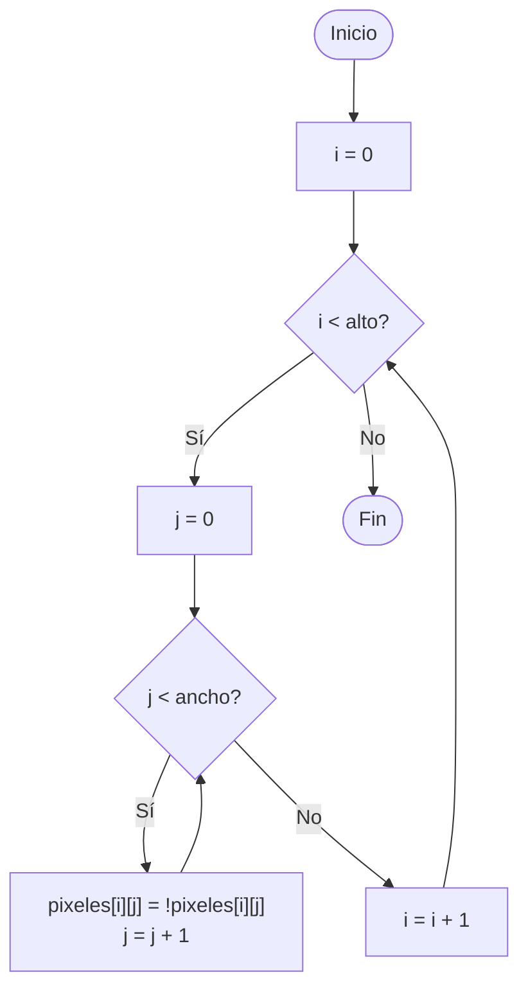

---

## 8. Pantalla → punto en movimiento (reto)

**Enunciado.** Usando `Pantalla`, simule un punto que se mueve. Parta de la posición `(0, 0)`. En cada turno el programa imprime la pantalla y pide una tecla:

- `d` derecha, `a` izquierda, `w` arriba, `s` abajo, `q` salir.

Antes de mover, apague el píxel actual con `off()`; después de mover, encienda el nuevo con `on()`. El punto no puede salir de la pantalla (use `get_ancho()` y `get_alto()`).

Variante: deje un rastro, es decir, no apague el píxel anterior.

**Conceptos:** uso combinado de `on` / `off`, getters para validar límites, menú con bucle.

**Diagrama de clase** (sin cambios respecto a B3)

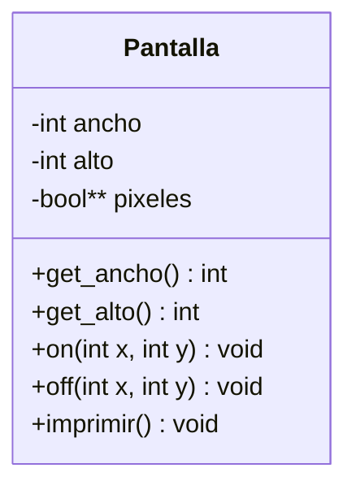

**Diagrama de flujo – programa principal**

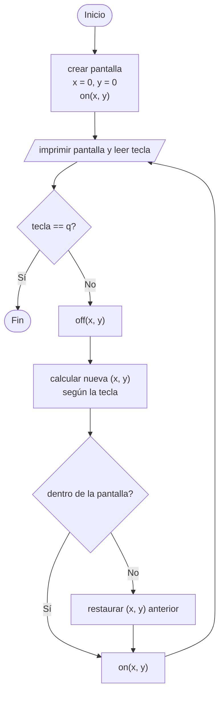
